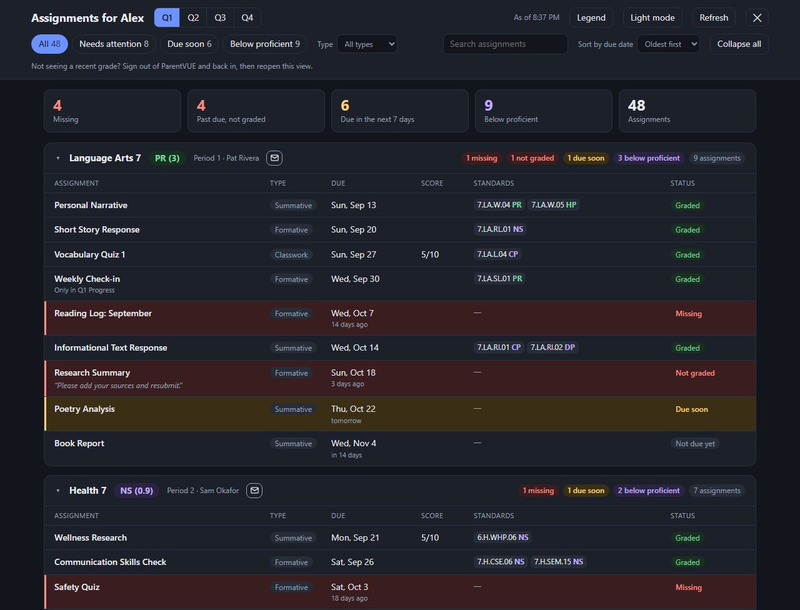
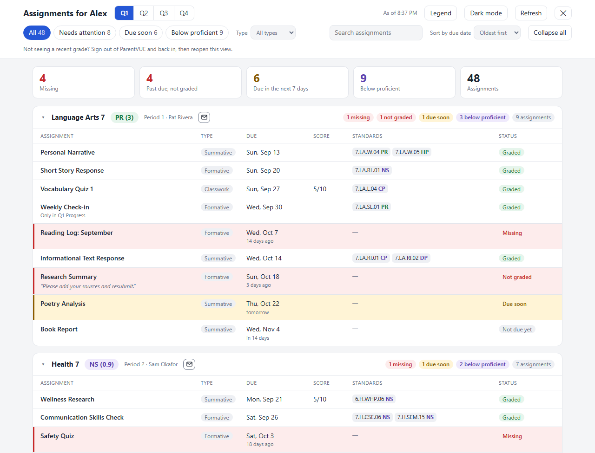

# ParentVUE: Better assignment view

> This project is independent. It is not affiliated with, or endorsed by, Edupoint or any school district.

A Chrome (and Edge) extension that adds a **Better assignment view** button to the ParentVUE gradebook. The button opens a full-page overlay with every class's assignments for a term in one place, with the things a parent cares about highlighted:

- **Red:** missing work, and work that is past due and not graded yet
- **Amber:** not graded yet and due in the next 7 days
- **Lavender marks:** standards scored below proficient (NS, DP, CP); proficient marks (PR, HP) are green. Only the mark is colored, not the whole standard
- One card per class in period order, with the overall mark, teacher and counts, and an envelope button (tooltip "Email teacher") that opens your mail app with the subject "Student - Class - Period N" (the student's first name, as in the title) filled in
- A term picker (Q1 to Q4, or whatever your school calls its terms), filters (All, Needs attention, Due soon, Below proficient), a Type filter (Formative, Summative, ...), search by assignment name, "Sort by due date" (oldest first by default), collapse all
- The heading names the student ("Assignments for Alex"); marks are color-coded the same way on each class's overall grade as on standards
- Light and dark themes with a toggle (remembered), and the portal's mark legend (HP, PR, CP, DP, NS; traits C, O, S, N) at the bottom, reachable from the **Legend** button
- Hover a standard's mark to see its description; teacher comments show under the assignment

### Dark Mode



### Light Mode



_Screenshots use made-up data._

Grades are shown exactly as ParentVUE reports them; the view only reorganizes them. Press **Esc** or the ✕ to return to the normal page.

## Install (Chrome or Edge, developer mode)

Requires Chrome or Edge 102 or newer on a desktop computer.

1. Download the latest `parentvue-better-assignment-view-<version>.zip` from the [Releases page](https://github.com/mattandes/parentvue-better-assignment-view/releases) and **unzip it** to a folder you will keep (for example in Documents). Chrome keeps reading the extension from that folder, so don't move or delete it.
2. Open `chrome://extensions` (in Edge: `edge://extensions`).
3. Turn on **Developer mode** (top-right toggle).
4. Click **Load unpacked** and choose the unzipped folder (the one that contains `manifest.json`). Chrome shows no site-access warning.
5. Pin the extension: click the puzzle-piece icon in the toolbar, then the pin next to **ParentVUE: Better assignment view**.

## Turn it on for your school (once)

The extension only works on a school's ParentVUE site after you approve that site.

1. Sign in to your school's ParentVUE and open any page.
2. Click the extension's toolbar icon and choose **Enable on <your school's address>**.
3. Chrome asks whether to allow the extension on that site. Choose **Allow**.
4. Open the **Grade Book**. The **Better assignment view** button appears at the bottom-right of the page, and keeps appearing on later visits with no more prompts.

To turn it off for a site, click the icon on that site and choose **Disable on this site**, then reload the page.

### If the button doesn't appear
- Click the extension icon while on the Grade Book page. If it offers **Enable on ...**, the Grade Book is on a different web address than the page you enabled (some schools redirect after sign-in). Enable that address too; each address is approved separately.
- If the icon says "This only works on ParentVUE pages", this page doesn't look like ParentVUE. Open the Grade Book and try again.
- If the overlay says your session expired, reload the page and sign in again.
- If you see "ParentVUE returned something unexpected", ParentVUE may have changed. Press **Refresh**, then reload the page.

## Supported schools

The extension reads the same internal data the ParentVUE page uses, which is the same on every school that runs ParentVUE (Edupoint Synergy "PXP2").

- **Tested:** Portland Public Schools (`or-psd-psv.edupoint.com`).
- **Expected to work, not yet verified:** Other ParentVUE sites.
- Schools that grade with percentages and letter grades instead of standards still get the assignment list, missing / not graded / due-soon highlighting and overall grade; the standards coloring only applies where the school uses standards marks.

Found a problem on your school's site? Please [open an issue](https://github.com/mattandes/parentvue-better-assignment-view/issues) and describe what you saw. **Don't include student names, grades or screenshots with personal details.**

## Privacy

- The extension asks for access to **one school site at a time, only when you click Enable**. It never asks for access to all websites.
- It runs only on the Grade Book page and calls only your school's ParentVUE site, using the sign-in you already have. It never sees or stores your password.
- Nothing is sent anywhere else and no analytics are collected. The only thing saved is your light/dark choice. Closing the overlay discards the data.
- The data comes from internal ParentVUE endpoints that are not documented, so a ParentVUE update could break the extension.

## Development

Node tooling is only for developing and building; the extension itself has no dependencies.

```powershell
nvm install 24.22.0     # the version in .nvmrc (nvm-windows 2.x also reads .nvmrc)
nvm use 24.22.0
npm ci
npm run check           # lint, format check, tests and the zip build
```

| Command | What it does |
|---|---|
| `npm test` | Runs the unit tests under Node |
| `npm run lint` / `npm run format` | ESLint (including security rules for HTML injection) / Prettier (`format:check` in CI) |
| `npm run package` | Builds `dist/parentvue-better-assignment-view-<version>.zip` from `extension/` |
| `npm run preview` | Serves the repo at <http://localhost:8765/>: `/test/index.html` runs the tests in a browser, `/test/preview.html` shows the overlay with made-up data |

To try the extension while developing, load the `extension` folder with **Load unpacked** and press the reload icon on its card after each change. More in `docs/testing.md`.

### Releasing
1. Change `version` in `extension/manifest.json` (it is the single source of the version) and in `package.json`.
2. Commit, then tag and push: `git tag v<version>` and `git push origin v<version>`.
3. The **Release** workflow checks that the tag matches the manifest version, runs the checks and publishes the zip on the Releases page.

## Layout

```
parentvue-better-assignment-view/
├── README.md  AGENTS.md  CLAUDE.md  LICENSE
├── extension/               the extension (this folder is what ships in the zip)
│   ├── manifest.json        Manifest V3; no site access at install time
│   ├── background.js        service worker: registers the scripts for each approved site
│   ├── popup.html/.js/.css  the toolbar popup: Enable / Disable for the current site
│   ├── portal.js            recognizes ParentVUE pages and builds the per-site permission pattern
│   ├── logic.js             pure rules: raw data to classes and assignments, term merge, status, flags
│   ├── ui.js                the overlay (in a shadow root)
│   ├── content.js           the button, the data calls and the glue
│   └── icons/
├── test/                    unit tests, browser test page, overlay preview, made-up fixtures
├── scripts/                 package.mjs (zip), serve.mjs (preview server), make-icons.mjs
├── docs/                    specs: overview, business rules, UI, API notes, testing; images/ has the README screenshots
└── .github/                 CI, release workflow, Dependabot
```

## License
MIT, see `LICENSE`.
